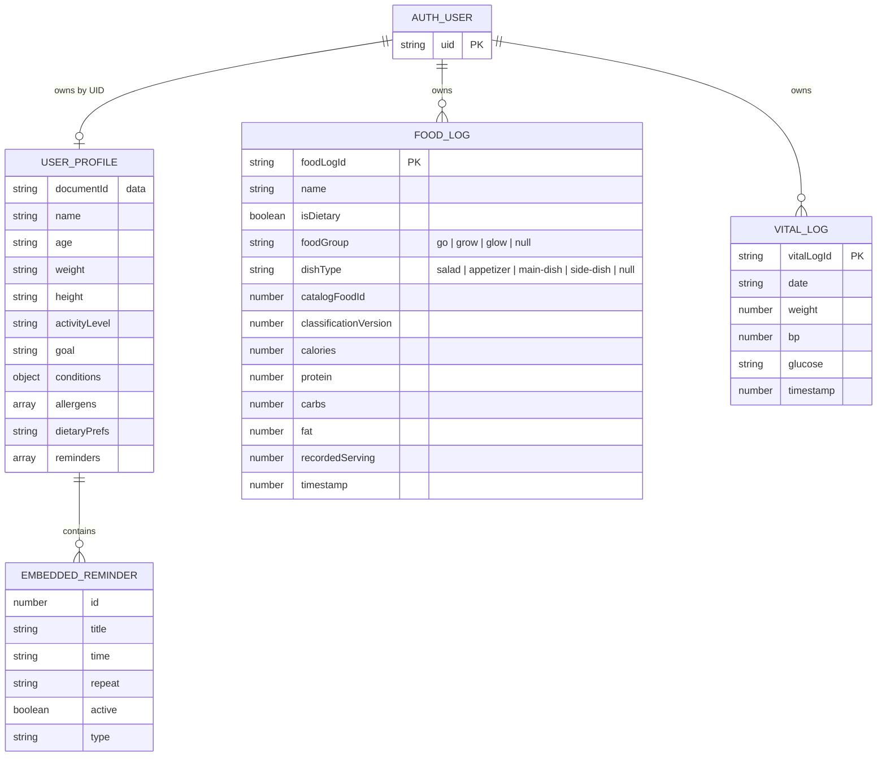

# Food for Fitness: Data Model

This document records the current data structures evidenced in the application and the fields needed by the requested revisions. **Planned revision** fields are proposed requirements, not verified existing fields.

## Firestore paths

The app uses the runtime `appId` segment, which defaults to `default-app-id`:

```text
artifacts/{appId}/users/{uid}/profile/data
artifacts/{appId}/users/{uid}/foodLogs/{foodLogId}
artifacts/{appId}/users/{uid}/vitalLogs/{vitalLogId}
```

The `uid` is the Firebase Authentication UID. The profile document has the fixed ID `data`; food and vital logs are stored in user-scoped subcollections. There is no separate Firestore user-parent record required by these paths.

## Current user profile

The profile is saved at `artifacts/{appId}/users/{uid}/profile/data`.

| Field | Current shape | Purpose |
|---|---|---|
| `isSetup` / onboarding state | boolean, depending on the flow | Tracks profile setup completion; verify the exact field used by each setup path before changing it |
| `name` | string | Display name |
| `age` | string in current UI state | Age |
| `weight` | string in current UI state | Weight in kg |
| `height` | string in current UI state | Height in cm |
| `activityLevel` | string | Activity selection |
| `goal` | string | Nutrition/fitness goal |
| `conditions` | object of booleans | Health-condition selections |
| `allergens` | string array | Allergen preferences |
| `dietaryPrefs` | string | Dietary preference |
| `reminders` | array of reminder objects | Embedded reminders; not a separate collection |

### Embedded reminder

| Field | Shape | Notes |
|---|---|---|
| `id` | number | Client-generated identifier |
| `title` | string | User-visible label |
| `time` | string | Local time, normally `HH:mm` |
| `repeat` | string | Includes `daily`, `weekdays`, or `once` |
| `active` | boolean | Whether the reminder is enabled |
| `type` | string | Includes meal, water, medication, or health |

## Current food log

Stored at `artifacts/{appId}/users/{uid}/foodLogs/{foodLogId}`. The document ID is based on the client-generated log ID.

| Field | Shape | Purpose |
|---|---|---|
| `name` | string | Food name |
| `emoji` | string | Display icon |
| `serving` | string | Base serving description |
| `category` | string | Existing catalog category (for example, food/protein type); do not assume it means Go/Grow/Glow |
| `catalogFoodId` | number or `null` | Catalog item matched during classification; null when an old entry cannot be matched |
| `isDietary` | boolean | Whether the food is in the reviewed dietary catalog; only `true` entries are shown or included in dietary nutrition totals |
| `foodGroup` | enum: `go`, `grow`, `glow`, or `null` | Primary Go/Grow/Glow group; null for entries not in the dietary catalog |
| `dishType` | enum: `salad`, `appetizer`, `main-dish`, `side-dish`, or `null` | Dish type, kept separate from the food group |
| `source` | enum: `food-log`, `camera` | Identifies manual catalog entries versus meals saved from the AI camera; camera entries stay in their Go/Grow/Glow list and receive a Saved Meal label |
| `classificationVersion` | number | Food-log classification schema version; current value is `2` |
| `calories` | number | Calories for the recorded portion |
| `protein`, `carbs`, `fat` | numbers | Macro estimates in grams for the recorded portion |
| `sugar` | number | Grams for the recorded portion |
| `sodium` | number | Milligrams for the recorded portion |
| `micronutrients` | nullable numeric object | Includes fiber, calcium, iron, potassium, vitamins, folate, magnesium, and sodium for the recorded portion; `null` means the catalog has no value |
| `micronutrientDataVersion` | number | Catalog micronutrient schema used for the log; current value is `2` |
| `purines` | string | Existing low/medium/high classification |
| `recordedServing` | number | Portion multiplier |
| `timestamp` | number | Unix epoch milliseconds |

The client adds the Firestore document ID as `id` when loading a log; it is omitted from the stored payload. New logs can only be created from catalog items explicitly marked dietary and assigned a Go/Grow/Glow group and dish type. Logs added through the AI camera save `source: camera` and appear in the same Go/Grow/Glow list as manually logged items, with a Saved Meal label; they still contribute to dietary nutrition totals. Manual catalog entries use `source: food-log`. When a camera recommendation matches a food already logged today, the UI asks for confirmation before creating another separate entry. Existing logs are classified by matching their food name against the catalog; unmatched or non-dietary entries receive `isDietary: false` and null group/type. These entries are retained in storage but excluded from Food Logs and nutrition totals. Older logs do not have reliable source metadata, so they remain under their existing Go/Grow/Glow category. Guest food logs use local state and are not durable after reload.

The dietary catalog currently includes Go, Grow, and Glow foods across salad, appetizer, main-dish, and side-dish types. Its group and dish-type fields are independent: for example, a salad can be Glow, while its dish type remains `salad`. Catalog entries not explicitly reviewed for the dietary list are not eligible for Food Logs. Newly curated options include brown rice, kamote, corn, oatmeal with banana, whole-wheat pandesal, grilled chicken breast, chicken and tuna salads, tokwa appetizers, Ensaladang Mangga, Ensaladang Pako, cucumber salads, vegetable sticks with yogurt dip, pechay, and fresh fruit salad without added sugar. Their listed serving sizes and nutrition values are estimates; users can adjust servings with the quantity input.

Food availability is separate from food-log history: available catalog foods remain selectable after logging, while the logged count only reflects entries already recorded in that food group. When dietary classifications change, increment the food-log classification version so existing records are rechecked against the reviewed catalog without deleting them.

### Planned revision: Gemini scan and recommendation result

The scan feature does not require food-group classification for detected ingredients. Go/Grow/Glow classification applies to curated food recommendations only. Do not overload the existing catalog `category` field, which has a different purpose.

| Proposed field | Shape | Purpose |
|---|---|---|
| `foodGroup` | enum: `go`, `grow`, `glow` | Classifies a curated food recommendation only; detected raw ingredients are not restricted to these groups |
| `confidence` | number from 0 to 1 or `null` | Model confidence for an ingredient identification, when available |
| `needsConfirmation` | boolean | Indicates that an uncertain result or quantity needs user review |
| `estimatedAmount` | number or `null` | Estimated amount of a detected ingredient; null if not reasonably estimable |
| `amountUnit` | string | Unit for the ingredient amount, such as `g`, `ml`, or `piece` |
| `caloriesKcal` | non-negative number | Estimated calories for the detected ingredient at the stated amount |
| `calorieBasis` | string | Human-readable amount basis for the detected ingredient's estimate |
| `status` | enum: `raw_ingredients`, `not_raw_ingredients`, `uncertain` | Indicates whether the image contains scannable raw ingredients |
| `message` | string | Brief guidance when the image is not raw ingredients or is unclear |
| `recommendations` | array of exactly 3 meal suggestion objects for valid scans | One dietary catalog meal suggestion for each Go/Grow/Glow group |
| `catalogFoodId` | number | ID of the exact reviewed dietary catalog entry; recommendations outside this catalog are rejected |
| `dishType` | enum: `salad`, `appetizer`, `main-dish`, `side-dish` | Exact dish type from the selected catalog entry |
| `components[]` | array of `{ name, estimatedAmount, amountUnit, caloriesKcal, calorieBasis, needsConfirmation }` | Each meal's ingredients/components and their individual calorie estimates |
| `caloriesPerServing` | non-negative number | Total estimated calories for this suggested meal per serving |
| `serving` | string | Serving basis for component and meal estimates (for example, `1 bowl`) |
| `nutritionEstimate` | object with `caloriesKcal`, `proteinG`, `carbsG`, `fatG`, and serving basis | Optional overall estimate for a single suggested meal; do not combine alternative suggestions |
| `mealStyle` | string | Contextually selected type of suggested dish (for example, salad, wrap, soup, appetizer, main dish, or side dish); not fixed to salad |

These are transient scan response fields, not persisted scan history. The scanner accepts raw ingredients only; cooked/prepared meals and ready-to-eat packaged foods return `not_raw_ingredients` or `uncertain` and no recommendations. Raw cooking ingredients are eligible whether loose or packaged. Uploaded images are resized to a maximum 960-pixel dimension and JPEG quality 0.72 before upload. The request asks for every distinct, clearly visible raw ingredient with no fixed item-count limit, limits each recommendation to 6 components, uses JSON response mode, requests low reasoning effort, and retries once with a larger output budget if the response is truncated. Include calorie estimates for every detected raw ingredient and every recommendation component, including calorie-containing items such as oil, sauces, or sugar. A detected amount may be null only when unclear, in which case `needsConfirmation` must be true. Recommendations must use exact IDs, names, Go/Grow/Glow groups, and dish types from the reviewed dietary catalog. The UI validates the response, displays each component estimate and total calories per serving, and only adds a food to the Food Log after the user selects its recommendation. The Go, Grow, and Glow recommendations are alternative options and their calories must not be summed together.

## Current vital log

Stored at `artifacts/{appId}/users/{uid}/vitalLogs/{clientId}`. Vital logs are persisted for an authenticated user and cached locally; they are **not memory-only**.

| Field | Shape | Purpose |
|---|---|---|
| `date` | string, `YYYY-MM-DD` | Local calendar date |
| `weight` | number or `null` | Weight in kg; may carry forward the latest value |
| `bp` | number or `null` | Current UI stores a single positive integer, not systolic/diastolic pair |
| `glucose` | normalized string or `null` | Glucose reading; accepts a positive value or range |
| `timestamp` | number | Unix epoch milliseconds |
| `clientId` | string | Offline-safe document ID; mapped to `id` in UI state |

## Food catalog and scan result

### Existing catalog

The Filipino food catalog is bundled in `src/constants/filipinoFoods.js`. Catalog records include an ID, name, calories, serving, category, emoji, allergens, vitamins, and purines; macro/micronutrient estimates are also derived in the application. Curated records also have Go/Grow/Glow and dish-type metadata. Food Log filters by both, including main dishes, appetizers, side dishes, and salads. The catalog is not a Firestore collection. A local cache may be used.

### Planned revision: transient Gemini result

The scan response can remain transient in application state. No new Firestore scan-history collection is required by the confirmed revision scope.

Structured response contract enforced by the scanner/UI. Each recommendation is a separate catalog-backed alternative with individually-calculated components and its own total per serving:

```json
{
  "status": "raw_ingredients",
  "message": "",
  "ingredients": [
    {
      "name": "uncooked rice",
      "foodGroup": "go",
      "confidence": 0.92,
      "estimatedAmount": 70,
      "amountUnit": "g",
      "caloriesKcal": 255,
      "calorieBasis": "estimated 70 g dry rice",
      "needsConfirmation": false
    },
    {
      "name": "chicken",
      "foodGroup": "grow",
      "confidence": 0.88,
      "estimatedAmount": 150,
      "amountUnit": "g",
      "caloriesKcal": 248,
      "calorieBasis": "estimated 150 g raw chicken",
      "needsConfirmation": false
    },
    {
      "name": "eggplant",
      "foodGroup": "glow",
      "confidence": 0.94,
      "estimatedAmount": 100,
      "amountUnit": "g",
      "caloriesKcal": 25,
      "calorieBasis": "estimated 100 g raw eggplant",
      "needsConfirmation": false
    }
  ],
  "recommendations": [
    {
      "foodGroup": "go",
      "catalogFoodId": 109,
      "name": "White Rice (Kanin)",
      "dishType": "side-dish",
      "serving": "1 cup",
      "components": [
        { "name": "rice", "estimatedAmount": 70, "amountUnit": "g", "caloriesKcal": 255, "calorieBasis": "estimated 70 g dry rice", "needsConfirmation": false }
      ],
      "caloriesPerServing": 255,
      "needsConfirmation": false
    },
    {
      "foodGroup": "grow",
      "catalogFoodId": 2,
      "name": "Chicken Adobo",
      "dishType": "main-dish",
      "serving": "1 cup",
      "components": [
        { "name": "chicken", "estimatedAmount": 150, "amountUnit": "g", "caloriesKcal": 248, "calorieBasis": "estimated 150 g raw chicken", "needsConfirmation": false },
        { "name": "soy sauce", "estimatedAmount": 10, "amountUnit": "ml", "caloriesKcal": 6, "calorieBasis": "estimated 10 ml", "needsConfirmation": false },
        { "name": "vinegar", "estimatedAmount": 15, "amountUnit": "ml", "caloriesKcal": 3, "calorieBasis": "estimated 15 ml", "needsConfirmation": false },
        { "name": "cooking oil", "estimatedAmount": 5, "amountUnit": "g", "caloriesKcal": 43, "calorieBasis": "estimated 5 g", "needsConfirmation": false }
      ],
      "caloriesPerServing": 300,
      "needsConfirmation": false
    },
    {
      "foodGroup": "glow",
      "catalogFoodId": 110,
      "name": "Ensaladang Talong (Eggplant Salad)",
      "dishType": "salad",
      "serving": "1 bowl",
      "components": [
        { "name": "eggplant", "estimatedAmount": 100, "amountUnit": "g", "caloriesKcal": 25, "calorieBasis": "estimated 100 g", "needsConfirmation": false },
        { "name": "egg", "estimatedAmount": 50, "amountUnit": "g", "caloriesKcal": 70, "calorieBasis": "estimated one egg", "needsConfirmation": false },
        { "name": "cooking oil", "estimatedAmount": 3, "amountUnit": "g", "caloriesKcal": 25, "calorieBasis": "estimated 3 g absorbed oil", "needsConfirmation": false }
      ],
      "caloriesPerServing": 120,
      "needsConfirmation": false
    }
  ]
}
```

Non-raw and uncertain responses use an empty `ingredients` array and an empty `recommendations` array with a short `message`. For valid scans, the parser requires three unique Go/Grow/Glow recommendations, checks each against the loaded dietary catalog, requires every recommendation to include a component matching a detected ingredient, validates all amounts/calorie values, and rejects totals that differ from component estimates by more than 10% (or 10 kcal for small totals). Do not automatically save scan suggestions as Food Logs; user selection is required.

## Other state and persistence

| Data | Current persistence |
|---|---|
| NutriBot/chat history | localStorage, keyed by profile name |
| Reminders | Embedded in profile in Firestore when available and cached in localStorage |
| Catalog | Bundled static source data, optionally cached in localStorage |
| Health logs | Firestore for signed-in users and local cache/device state |
| Guest food logs | React state only; no automatic sign-in migration was verified |
| Navigation and form state | React state |
| Notification schedule | Device/browser scheduling state, not a Firestore collection |

## ERD-style view



## Source references

- Firebase reads/writes and collection paths: `src/services/firebaseService.js`
- Shared food and vital state/handlers: `src/hooks/useFoodFitnessApp.jsx`
- Food catalog: `src/constants/filipinoFoods.js`
- Gemini image analysis entry point: `src/services/aiService.js` and `src/features/camera-ai/CameraScanner.jsx`
