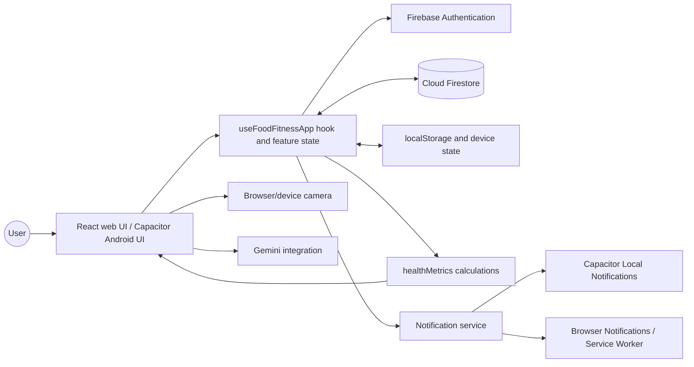

# Food for Fitness: System Flow

This document separates the two official adviser revisions from the additional changes the user wants to include in the project plan.

## Current high-level architecture

The UI is built with React components and shared state/callbacks from `useFoodFitnessApp`; no centralized Redux store was found. Firebase data is scoped under the authenticated user's UID. Web and Android share the app UI, with Capacitor providing the Android shell and native notification integration.

## Current account and data flow

1. The app initializes Firebase when configuration is available and observes Firebase Authentication state.
2. Users can use the authentication/profile flows. Profile setup saves the profile to `profile/data`.
3. For an authenticated user, the app loads the profile and subscribes to `foodLogs` and `vitalLogs`.
4. Food and vital entries update app state and are written to the user's Firestore subcollections when cloud storage is available; local caching/offline handling is also used.
5. Reminders are kept in app state, cached locally, and stored as an array in the profile when cloud storage is available.
6. Analytics derive nutrition totals and health metrics from profile values and logs.

When Firebase is not configured, some account/demo flows may still render, but they do not represent durable cloud authentication or storage. Do not describe demo mode as a production authentication path.

## Current food logging flow

1. The user searches or browses the bundled food catalog, or opens the camera scanner.
2. The catalog path selects a food and serving multiplier.
3. `handleAddFood` scales nutrient values by the selected serving and creates a timestamped log entry.
4. The entry is displayed in app state and written to Firestore for an authenticated user. Catalog entries are marked `source: food-log`; items added from the AI scanner are marked `source: camera` and appear in the same Go/Grow/Glow category list, with a Saved Meal label.
5. The Food Logs interface can remove a log; persisted records are deleted from Firestore.

Camera-saved meals remain part of the dietary log and nutrition totals, are grouped by Go/Grow/Glow like other entries, and carry a Saved Meal source label. If the same food was already logged today, the scanner asks before adding another separate entry. Existing entries without source metadata keep their current category.

## Planned revision 1: raw-ingredient scan and food recommendations

### Target flow

1. The user captures or selects an image containing raw ingredients/materials.
2. The app resizes/compresses the image, loads a compact reviewed dietary catalog, and sends a JSON-constrained Gemini prompt with low reasoning effort to identify every distinct, clearly visible raw ingredient without an item-count or Go/Grow/Glow restriction. Raw cooking ingredients are eligible whether loose or packaged; prepared meals and ready-to-eat packaged foods are not. If Gemini truncates the response, the app retries once with a larger output budget.
3. The app validates the response and shows detected ingredients. Unclear detections should be marked as uncertain rather than stated as fact.
4. Based on the detected ingredients, Gemini suggests catalog-backed dietary meals that could be made from them; the user explicitly chooses any food to add to the Food Log.
5. The recommendations include one food from each group: Go, Grow, and Glow.
6. Choose meal types contextually from the detected ingredients. Salad is only an example: if the user scans lettuce, suggest suitable dietary options such as a salad, lettuce wraps, or another feasible dish depending on the other ingredients; do not force every scan result to be a salad.
7. Each suggested meal shows its own estimated calories per serving, the individual calorie estimates of its ingredients/components, and a total for that meal/serving.
8. Keep each suggested meal's total separate. Go, Grow, and Glow suggestions are alternative options, so their calorie values must not be added together as one meal total.

### Proposed response shape

Use a stable, validated response shape (documented in [Data model](DATA_MODEL.md)) containing every detected raw edible ingredient, including leafy greens such as lettuce, without requiring each ingredient to belong to a Go/Grow/Glow group. Return three suggested dietary catalog foods—one recommendation per group. For every suggestion, return its serving size, each ingredient/component with an individual estimated calorie value, and the total estimated calories for that meal per serving. Include calorie-containing ingredients such as sugar. Keep totals separate because the three suggestions are alternatives, not one combined meal. If image-based quantity is unclear, show the estimate as uncertain or request user confirmation; do not imply an exact measurement. The scan itself only suggests and must not automatically save food to Food Logs.

### Accuracy and guardrails

- Prompt guardrails limit the request to raw-ingredient recognition and ingredient-based food recommendations; prompting alone cannot guarantee model behavior.
- Validate raw-ingredient scan status, required fields, catalog IDs, allowed food groups and dish types, non-negative calorie estimates, and response size. Reject recommendations whose component calorie estimates do not match the per-serving total within tolerance.
- Require a quantity/serving basis alongside each suggested-meal component's calorie estimate and the meal total; flag unknown quantities instead of inventing exact amounts.
- Do not promise perfect recognition for crowded, obscured, low-quality, or ambiguous images.
- Label calories as estimates and show the serving basis.

## Additional requested changes

These are additional requested changes, separate from the official two-item adviser list:

### Food Logs and adding foods

1. Limit Food Logs to dietary foods, classified into **Go**, **Grow**, and **Glow**. Confirm the exact dietary inclusion rules and food list.
2. Show only Go/Grow/Glow in Food Logs; remove **All Foods**, **Suggestions**, and **Other Foods**.
3. Add a **Confirm** action when adding food; after confirmation, save it and show it in the appropriate group.

### Meal suggestions

- Consider suitable styles such as salad, appetizer, main dish, and side dish when generating dietary meal ideas. Select the style based on the scanned ingredients; these are examples, not mandatory outputs for every scan.
- Show per-serving calories and the requested estimated macro summary.

### UI overhaul (after functionality)

- Refresh the UI for both web and Android after functionality is stable and tested.
- Apply Responsive Web Design to web/PWA and mobile web so the layout adapts to phone, tablet, desktop, and resized browser widths.
- Give Android its own presentation where appropriate, while sharing the underlying logic/services with web.
- Ensure navigation works well during scrolling and validate both platform experiences after the redesign.

## Nutrition and analytics flow

1. Profile information, goals, and health-condition flags feed target calculations.
2. Confirmed food-log entries feed daily calorie, macro, sugar, sodium, and micronutrient totals.
3. Vital readings feed the health-tracking views.
4. Dashboard and report screens display derived totals/trends.

Displayed targets and AI-derived nutrition values are estimates and should not be described as individualized medical advice.

## Reminders and platform flow

- On Android, the notification service routes reminders through Capacitor Local Notifications.
- On web, reminders use browser notification/service-worker capabilities when available; behavior depends on browser permissions and runtime.
- The same React application is packaged for Android. Responsive layout and navigation changes should be done after the revised functional flows are stable.

## Implementation evidence

- App wiring and route/tab rendering: `src/App.jsx`
- Shared application state and food/vital handlers: `src/hooks/useFoodFitnessApp.jsx`
- Gemini image-analysis entry point: `src/services/aiService.js`
- Camera scanner UI: `src/features/camera-ai/CameraScanner.jsx`
- Firestore paths, subscriptions, and writes: `src/services/firebaseService.js`
- Nutrition calculations: `src/utils/healthMetrics.js`
- Notification platform routing: `src/services/notificationService.js`
